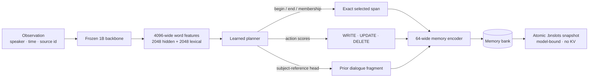
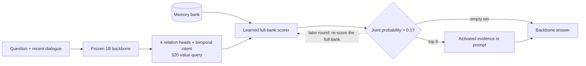
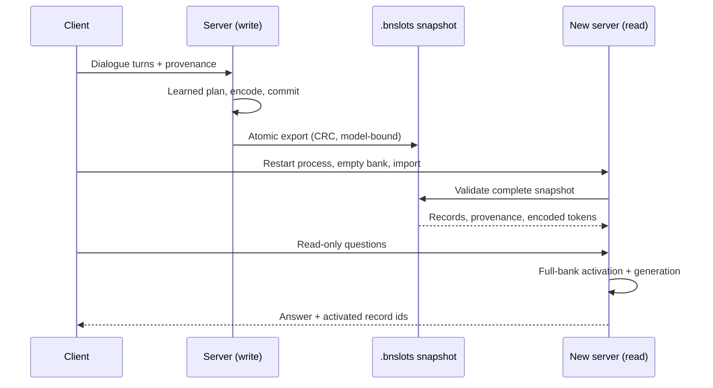

# 158BitNet

158BitNet is a small C inference runtime for OpenBMB BitCPM CANN GGUF models.
It focuses on low-bit BitNet-style decode on ARM CPUs, especially Apple Silicon
and Android arm64 devices. The repository includes a core `bitnet` library,
examples, an OpenAI-compatible HTTP server, LoRA loading, KV-cache reuse, Android
cross-compilation, tests, profiling tools, and a learned persistent-memory
subsystem on top of the frozen backbone.

One runtime serves both model families: `bonsai_server` speaks the OpenAI API
for the BitCPM 0.5B/1B/3B/8B files and for the Qwen3.5-hybrid Ternary-Bonsai
27B checkpoint, with optional DSpine speculative decoding for the 27B.

## Local Changes Versus The Published Repository

The published tree (`origin/main`, commit `36376f3`) holds the BitCPM/CANN
runtime and the neural-memory subsystem. Everything listed here is in the
local branch and has not been pushed upstream; the published files are
extended, not replaced.

| Tracked file | Lines | What the change adds |
| --- | ---: | --- |
| `CMakeLists.txt` | +78 | `bonsai_generate`, `bonsai_spec`, `bonsai_server` targets, the optional Vulkan backend, `test_ptq_p2` and the Vulkan benches |
| `src/bitnet.c` | +383/-26 | Vulkan staging and the CPU/GPU row split for the ternary matvecs; `bitnet_output_logits_blockscale` so a non-qwen35 family can share the output pool |
| `src/gguf.c`, `src/gguf.h` | +59 | `gguf_read_tensor_at` and `gguf_release_data`: `pread` a tensor window straight into GPU-visible memory and drop the page-cache copy, so a 5.95 GB model is never resident twice |
| `src/quant_tq2_0.c`, `src/quant_tq2_0.h` | +335/-3 | the batched B=1..16 matmul used by the block verify, its `_rows` form for a hybrid split, and `bitnet_fp32_to_fp16` |
| `README.md` | +336 | the 27B, speculative-decoding, optimization and measured-accuracy sections, plus this comparison |

New subsystems, all untracked in the published tree:

- `src/bonsai.c`, `include/bonsai.h` -- the `qwen35` graph (Ternary-Bonsai
  27B): PTQ1_0 weights, Prism-Hadamard folding, full-attention and gated delta
  net blocks, `bonsai_eval_block` verify, replay cache, worker park.
- `src/quant_ptq1_0.c`, `src/quant_ptq1_0.h` -- `PTQ1_0` kernels, including
  the 2-bit i8mm repack the 27B verify runs on.
- `src/dspine.c`, `include/dspine.h` -- the DSpine block drafter.
- `src/minicpm.c`, `src/minicpm.h`, `src/output_head.h` -- the
  `minicpm`/`llama` graph (BitCPM/MiniCPM4) under the same `bonsai_*` API,
  its ternary output head and prefill chunking, and the shared output-pool
  entry points.
- `src/qwen3.c`, `src/qwen3.h` -- a dense Qwen3 GGUF runtime with block
  verify (an experimental second target for the drafter).
- `src/unicode_data.c`, `src/unicode_data.h` -- Unicode category tables used
  by the tokenizer's byte fallback.
- `src/vk/`, `src/gpu_ops.h` -- the Vulkan backend: `.comp` shaders with
  embedded `_spv.h` headers, and the stage opcodes shared with
  `src/bonsai.c`.
- `tools/` -- `bonsai_server.c` (the unified OpenAI server), `bonsai_spec.c`
  (speculative-decoding driver), `bonsai_generate.c`, `bonsai_ids.c`,
  `ctx_probe.c`, `gguf_dump.c`, `tq2_decode_bench.c`.
- `scripts/` -- device builds and deployment: `build_server_host.sh`,
  `build_server_board.sh`, `build_bonsai.sh`, `build_spec_host.sh`,
  `serve_phone.sh`, `serve_board.sh`, `sync_board_src.sh`,
  `gen_shader_header.sh`, `test_vk_kernels.sh`, `validate_vk.sh`,
  `deploy_and_validate.sh`, `bench_server.sh`.
- `tests/` -- `test_ptq_encode.c`, `test_ptq_p2.c`, `bench_p2.c`,
  `bench_ptq_cpu.c`, `bench_tq2_batched.c`, `test_vk_kernels.c`,
  `test_vk_matmat.c`, `test_vk_hybrid.c`, `test_vk_tq2_bench.c`,
  `test_vk_tq2_matmat_bench.c`.

The rest of the difference is not source: stray `*.o` files and
`build-bonsai/` are local build output, and `config.json` is the HF config
that ships with the DSpine draft checkpoint (the runtime reads the
`safetensors` headers, not this file). `git diff 36376f3` on the local
branch reproduces this list exactly.

## Models

The project targets BitCPM CANN GGUF models from OpenBMB, including the public
[BitCPM-CANN-8B-gguf](https://huggingface.co/openbmb/BitCPM-CANN-8B-gguf)
release and the local `bitcpm4-{0.5b,1b,3b,8b}-tq2_0.gguf` family used during
development.

In this codebase, "1.58-bit" means BitNet-style ternary weights, not a 1.58B
parameter count. The local model sizes are named by parameter scale, for example
`0.5b`, `1b`, `3b`, and `8b`; the low-bit weight format is usually `TQ2_0`.

Typical GGUF metadata for these models:

- GGUF v3 container with OpenBMB CANN finetune metadata.
- 32K context length in the model metadata.
- LLaMA/MiniCPM-style chat template using `<|im_start|>` and `<|im_end|>`.
- Main transformer projections in `TQ2_0`.
- Embedding/output tensors may use `F16`, `Q4_K`, `Q6_K`, or tied output paths,
  depending on the model size.
- Vocabulary size is 73,448 for the local BitCPM4 models.

Place models under `models/`:

```sh
models/bitcpm4-0.5b-tq2_0.gguf
models/bitcpm4-1b-tq2_0.gguf
models/bitcpm4-3b-tq2_0.gguf
models/bitcpm4-8b-tq2_0.gguf
```

The 27B family has its own files, described in the next section:

```sh
models/Ternary-Bonsai-2-27B-PTQ1_0.gguf
models/dspine27.safetensors
```

You can also inspect a model directly:

```sh
./build/gguf_inspect models/bitcpm4-1b-tq2_0.gguf
```

## Ternary-Bonsai 27B (qwen35)

The repo also runs a model that is not part of the BitCPM family: the
Qwen3.5-hybrid `Ternary-Bonsai-2-27B-PTQ1_0.gguf` (5.95 GB,
`general.architecture = qwen35`) with `PTQ1_0` ternary weights.

- 64 blocks, hidden 5120, FFN 17408, 24 query heads and 4 KV heads of 256;
  every fourth block is full attention and the rest are gated delta net (GDN).
- The weights are Prism-Hadamard folded (`W_f = W * D * H`), so every matmul
  input is transformed as `x' = H(D*x)` first, the embedding lookup applies the
  inverse, and the GDN output projection permutes its heads. `src/bonsai.c`
  implements the graph and the fold, `src/quant_ptq1_0.c` the weights.
- The int8 LM head alone is 1.27 GB and is cached at load; the whole file is
  5.95 GB, so a board that holds it should not hold a BitCPM next to it (the
  server's `--max-resident 1` handles that).

`bonsai_load_model()` opens a file of either family and dispatches on
`general.architecture`: `qwen35` runs the `src/bonsai.c` graph, `minicpm` and
`llama` the `src/minicpm.c` graph, through one API, one binary and one thread
pool.

Tuning that matters:

- The 2-bit i8mm kernel is worth 1.6x on the block verify. `BQ_P2=1` (server
  default) builds the repacked weights; on a CPU without `i8mm` the kernel
  falls back to the dotprod path with the base-3 trit decode.
- The GPU share is board-specific, not a free win: `--gpu-pct 45 --mm-gpu 0`
  is the Cix board's optimum (its A720 cores with i8mm outrun the Mali), while
  the SM8550 phone wants `--gpu-pct 69 --mm-gpu 30`. The library default
  (`BQ_GPU_PCT=69`) is the Adreno setting.
- 8 threads on the 8-core boards; `-t 3` halves the decode rate.

Greedy decode, 32-64 output tokens:

| Board | Plain | With the DSpine drafter |
| --- | ---: | ---: |
| Cix P1, Mali-G720, 8 threads | ~2.3 tok/s | 5.0-5.2 tok/s |
| SM8550 phone, Adreno 740, 4 threads | 2.35-2.42 tok/s | 3.3-3.6 tok/s |

Context is memory bound, not file bound: the checkpoint declares 262144
positions, but its KV cache is 128 KB per token, so a 28 GB board runs out of
memory long before the server's 32768 cap.

## Snapdragon 865 Best Known Results

Latest measurements on the Snapdragon 865 (SM8250) board used for this project
(`OR65M52X12U245200046`: Ubuntu 24.04, one A77 at 2.84 GHz plus three at
2.42 GHz and four A55s, 11 GB RAM, ~23.5 GB/s DRAM read ceiling). One binary,
`bonsai_server --threads 3 --ctx 2048 --no-gpu`, greedy decoding, 64 generated
tokens from a 26-token prompt, best of three runs. Decode is the steady-state
rate the server reports in `perf.decode_tokens_per_s`; prefill is for the same
26-token prompt.

| Model | GGUF file | Decode | Prefill |
| --- | --- | ---: | ---: |
| 0.5B | `bitcpm4-0.5b-tq2_0.gguf` | 153-155 tok/s | ~310 tok/s |
| 1B | `bitcpm4-1b-tq2_0.gguf` | 50-51 tok/s | ~93 tok/s |
| 3B | `bitcpm4-3b-tq2_0.gguf` | 20.4-20.8 tok/s | ~32 tok/s |
| 8B | `bitcpm4-8b-tq2_0.gguf` | 9.3-9.7 tok/s | ~16 tok/s |

Use these numbers as regression guardrails. When comparing new optimizations,
keep the model, thread count, context length, prompt shape, and background
process state the same: a shorter generation reads higher, at 32 tokens
156-160 / 54 / 22-24 / 10.9 tok/s on the same board.

## Architecture

The runtime is intentionally compact:

- `src/bitnet.c`: model loading, forward pass, KV cache, LoRA application, output
  projection, and decode-facing API.
- `src/quant_tq2_0.c`: ternary `TQ2_0` kernels, including ARM NEON paths.
- `src/bonsai.c`: the `qwen35` graph (Ternary-Bonsai 27B) -- PTQ1_0 weights,
  Prism-Hadamard folding, gated delta net blocks, block verify.
- `src/minicpm.c`: the `minicpm`/`llama` graph (BitCPM/MiniCPM4) -- TQ2_0
  projections, ternary output head, prefill chunking.
- `src/dspine.c`: the DSpine block drafter used by speculative decoding.
- `src/quant_ptq1_0.c`: `PTQ1_0` kernels, including the 2-bit i8mm repack.
- `src/vk/vk_backend.c`: optional Vulkan compute back end for the ternary
  matvecs (built when Vulkan is found).
- `tools/bonsai_server.c`, `tools/bonsai_spec.c`, `tools/bonsai_generate.c`:
  the unified HTTP server, the speculative-decoding driver and the CLI.
- `src/quant_q6k.c`, `src/quant_q4k.c`: GGUF quantization helpers used by
  embeddings and output projection.
- `src/tokenizer.c`: GGUF tokenizer support.
- `examples/minimal_generate.c`: minimal CLI generation.
- `examples/openai_server.c`: OpenAI-compatible HTTP server using Mongoose and
  cJSON from `src/third_party/`.
- `tools/train_xiaoli_lora.c`: small local LoRA generation tool used by tests.
- `tests/`: correctness tests, HTTP API tests, Android-relevant profiling, and
  decode benchmarks.

High-level decode flow:

1. Load GGUF metadata, tokenizer, tensor descriptors, and model weights.
2. Tokenize prompt text with the model tokenizer.
3. Prefill prompt tokens into a `bitnet_context_t`.
4. For each generated token, run one-token decode, sample greedily or with
   repetition penalty, append to history, and update KV cache.
5. Reuse cached KV state for multi-turn requests when `session_id` is provided.

A model that has a draft takes a different path: the drafter proposes a block,
one batched forward verifies it (`bonsai_eval_block`), and the longest agreeing
prefix is appended while the rest is rolled back.

Key runtime features:

- `TQ2_0` low-bit matrix-vector kernels for transformer projections.
- Output projection acceleration with expanded Q6K/Q8 cache paths where
  applicable.
- F32 and Q8 KV-cache modes through `bitnet_set_kv_cache_type`.
- OpenAI-compatible completions/chat API, including streaming SSE responses.
- Session KV reuse and full-history de-duplication for multi-turn HTTP calls.
- External LoRA loading with `--lora` and `--lora-scale`.
- One binary for the BitCPM (`minicpm`/`llama`) and Ternary-Bonsai 27B
  (`qwen35`) families, selected by `general.architecture`.
- Speculative decoding with a DSpine block drafter or a GGUF draft model.
- Ternary output head, batched TQ2_0 block verify and chunked prefill.
- Optional Vulkan compute back end for the ternary matvecs.

## Speculative Decoding

A drafter proposes a block of tokens and the target verifies the whole block in
one batched pass; the longest agreeing prefix is kept and the rest is rolled
back. Acceptance is decided by comparing argmax rows, so the speculative path
is greedy -- a request with `temperature > 0` falls back to sampling.

Two kinds of draft are supported:

- `-d draft.safetensors`: the DSpine block drafter, `qwen35` targets only. It
  reads five residual-stream layers of the target and borrows its embedding, LM
  head and thread pool (`src/dspine.c`).
- `-D draft.gguf`: any GGUF this binary can load, from either family, as long
  as the vocab matches. All four BitCPM files share one vocabulary.

In the server the draft is attached to the `--model` before it:

```sh
./bonsai_server --threads 8 --ctx 2048 \
  --model bonsai27b=models/Ternary-Bonsai-2-27B-PTQ1_0.gguf \
  --draft models/dspine27.safetensors \
  --model cpm8b=models/bitcpm4-8b-tq2_0.gguf
```

`--block N` sets the server default and `--model-block N` (after the `--model`
it belongs to) or the per-request `spec_block` overrides it, and
`"spec": false` forces the plain path on a model that has a draft, so both
engines can be compared through one process; `perf.engine` reports which one
ran (`decode`, `spec-dspine`, `spec-gguf`).

What the block size buys: on the SM8550 the 27B keeps 1.8-2.7 tokens per round
(acceptance ~73% per token) at B=2-3, and larger blocks grow the verify faster
than the accepted-prefix length. On Cix B=2 is 1.80 tokens/round with a 346 ms
verify; B=4 reaches 2.33 tokens/round but costs 503 ms, because the 2-bit
kernel pairs rows (`pairs = ceil(B/2)`) and the SMMLAs double.

When it pays: only for the 27B. After the output-head and thread fixes the
BitCPM 8B decodes at 13.0 tok/s on its own against 9.3 with a 1B draft -- its
block verify amortizes only 1.34-1.54x while acceptance is ~69%, so a draft
loses unless the accepted prefix exceeds block/1.4.

A rollback cache (`bonsai_replay_cache_init`, on by default, `BQ_RP_CACHE=0`
disables it) reuses the GDN qkv/alpha/beta the verify already computed, so a
partial acceptance re-runs only the recurrence: replay 61 -> 22 ms per round on
the SM8550, byte-identical output.

`tools/bonsai_spec.c` checks the machinery directly: `--check` compares the
sequential forward against `bonsai_eval_block()`, `--bench` times one block
verify against B single-token forwards.

## Important Optimizations

The runtime has gone through several rounds of optimization for decode-heavy
BitCPM/BitNet inference. The most important changes are below.

### TQ2_0 Ternary Kernels

`TQ2_0` stores 256 ternary weights per block in 64 packed bytes plus one FP16
scale. The logical weight values are `{-1, 0, +1}` with one reserved 2-bit code.
This makes decode mostly a memory-layout and dot-product problem rather than a
general floating-point GEMM problem.

The implementation keeps the llama.cpp-compatible interleaved element ordering:

- 64 packed bytes encode 256 weights.
- Each byte stores four 2-bit codes.
- The four codes are interleaved by 32-element strides.
- Per-block scales are extracted once into scale caches during model loading.

The baseline scalar path is kept for correctness and non-NEON builds, but ARM
decode uses specialized int8/NEON paths.

### LUT-Based Matmul

The early optimized path builds a lookup table from the current activation
vector, then uses packed weight bytes as indices into that LUT.

For a row block:

1. Build a LUT for the current activation vector.
2. For each packed `TQ2_0` byte, look up the precomputed contribution of its four
   2-bit codes.
3. Apply the per-block scale and accumulate the row result.

This avoids repeatedly unpacking each ternary code into floats. Pair kernels such
as gate+up share one LUT for two projections, reducing repeated preprocessing.

### VTBL / `vqtbl1q_s8` Unpack

On ARM NEON with dot-product support, the runtime uses `vqtbl1q_s8` to decode
2-bit ternary nibbles. A table lookup replaces the usual chain of `AND`, `USHR`,
masking, and subtract operations.

The NEON path uses the "bsums" trick:

- Decode codes as `{0, 1, 2}` instead of `{-1, 0, +1}`.
- Compute `dot(code, activation)`.
- Subtract the precomputed activation block sum once.

This removes a subtraction from the inner unpack loop and lets the hot path
combine `vqtbl1q_s8` with `vdotq_s32`.

### `vdotq_s32` Dot Product

For ARMv8.2-A dot-product targets, the hot low-bit kernels use `vdotq_s32` over
int8 activations and unpacked ternary codes. This is used in:

- Single-row `TQ2_0` projection.
- Pair projection for gate+up.
- 4-row and 8-row grouped kernels.
- Q6K/Q8 output projection.

The kernels use dual accumulators in several places to break dependency chains
and expose more instruction-level parallelism to the CPU.

### I2_S / I2S Weight Reordering

The I2_S path reorders `TQ2_0` weights at model load time into a 4-row packed
2-bit layout. The one-time load cost buys a simpler decode layout:

- Four rows are packed together to improve activation reuse.
- Per-row/per-block scales are stored beside the reordered weights.
- Parallel APIs support single projection, paired projection, and fused Q/K/V.
- The runtime can compute Q/K/V in one dispatch and gate+up in one paired kernel.

This reduces repeated reads of the same activation vector and cuts thread-pool
dispatch overhead for common transformer projection groups.

Relevant code:

- `bitnet_tq2_0_reorder_to_i2s`
- `bitnet_tq2_0_matmul_i2s_neon_parallel`
- `bitnet_tq2_0_matmul_i2s_neon_pair_parallel`
- `bitnet_tq2_0_matmul_i2s_qkv_parallel`

### TL1 / `vqtbl1q_s8` GEMM Path

The TL1 path is another layout experiment inspired by llama.cpp/BitNet kernels.
It converts `TQ2_0` into consecutive nibble pairs and builds a compact
`vqtbl1q_s8` LUT from the activation vector.

The TL1 pipeline is:

1. Reorder `TQ2_0` interleaved weights to TL1 at load time.
2. Quantize and preprocess the current activation vector into a table.
3. Process blocked row groups while sharing the LUT across many rows.

This path is useful for comparing table-lookup GEMM behavior against I2S and the
direct VTBL/dotprod kernels.

### RMSNorm + Quantize Fusion

For I2S decode, the runtime fuses RMSNorm output production with int8 activation
quantization where possible:

- Attention RMSNorm can produce the normalized hidden state and the int8 vector
  used by Q/K/V in one pass.
- FFN RMSNorm can similarly feed gate/up projection quantization.
- FFN down uses a known max from `silu(gate) * up` to avoid an unnecessary second
  max scan.

The goal is to reduce memory bandwidth and avoid repeating normalization or
quantization work in each projection.

### Fused Projection Dispatch

Several transformer projections naturally share the same input vector. The
runtime exploits that:

- Q/K/V can be computed together through the I2S QKV parallel path.
- Gate+up can be computed through paired kernels and one shared quantized input.
- Paired LUT kernels share the activation LUT across two matrices.

This matters on mobile CPUs because thread-pool scheduling and repeated input
quantization can become visible at short decode lengths.

### Output Projection Cache

The output layer can dominate decode for small and medium models because it has
to score the full vocabulary. The runtime builds expanded output caches at model
load time when the model format allows it:

- Q6K output can be expanded into Q8 rows with compact scale storage.
- F16 tied embeddings can be converted into block-scaled Q8 rows.
- Output rows are evaluated in 4-row or 8-row NEON dot-product kernels.
- The output worker pool splits vocabulary rows into chunks and parallelizes
  logits computation.

Android uses smaller default chunks for some compact output shapes to improve
load balancing on Snapdragon-class devices. `BITNET_OUTPUT_CHUNK_ROWS` can be
used for experiments.

### Multi-Threaded Decode

The runtime uses a small global worker pool for selected hot paths instead of
creating threads per request. The default thread count is 3 and can be overridden
with:

```sh
BITNET_NUM_THREADS=4 ./build/openai_server models/bitcpm4-1b-tq2_0.gguf
```

Threaded work is used where it pays off, especially output projection and large
TQ2 projections. Small matrices can stay single-threaded to avoid scheduling
overhead.

### Q8 KV Cache

The public API exposes both F32 and Q8 KV-cache modes:

```c
bitnet_set_kv_cache_type(ctx, BITNET_KV_CACHE_Q8);
```

Q8 KV cache stores keys and values as int8 plus per-head scales. During
attention, query heads are quantized and dotted against cached int8 keys, while
cached int8 values are accumulated back into float attention outputs. This cuts
KV-cache memory bandwidth and storage versus F32 cache, which becomes more
important as context length grows.

### HTTP Session KV Reuse

The OpenAI-compatible server keeps per-session `bitnet_context_t` objects when a
request provides `session_id`.

The server reports:

- `cached_tokens`: tokens already present in the session context.
- `reused_tokens`: tokens reused from cache for this request.
- `context_tokens`: current session context length after generation.

If a client sends full conversation history on every turn, the server compares
the token prefix and skips re-evaluating the cached portion. This makes multi-turn
chat faster without requiring clients to omit history manually.

### Sparse Output LoRA

External LoRA is supported for transformer projections and the output layer. The
example Xiaoli LoRA used in tests mostly changes a sparse set of output tokens.
At load time, the runtime detects non-zero output rows in the LoRA B matrix and
only updates those logits during decode.

This keeps LoRA behavior in adapter weights while avoiding a dense full-vocab
LoRA pass for mostly sparse output adapters.

### Unified Runtime For Two Families

`src/minicpm.c` is the BitCPM graph under the same `bonsai_*` API as the
`qwen35` engine: `bonsai_load_model()` reads `general.architecture` and hands
the file to the right graph, and the BitCPM side reuses the neutral library
kernels (TQ2_0/Q4_K/Q6_K/Q8_K, ops, tokenizer, GGUF). The server exports
`--threads` through `BITNET_NUM_THREADS` before the first load, because the
TQ2_0 pool is sized from the environment, and it parks the decode workers once
per request (`bonsai_park_workers()`); an unparked pool holds ~48% of eight
cores and cost the next 27B request about 7%.

### Batched TQ2_0 Block Verify

`bitnet_tq2_0_matmul_batched_i8_rows` computes one weight row against up to 16
activation rows, decoding each 256-weight block once and dotting it against
every row, so a speculative verify streams the matrix once instead of once per
drafted token. The bodies are compile-time sized: B <= 4 uses four accumulators
per row, B 5-8 two, and B 9-16 a decode-once form. Measured on the 8B, a B=8
block verify is 469 ms, 58.7 ms per row, 1.34x a sequential token. Prefill runs
through the same kernel.

### Prefill Chunking

The prefill is instruction bound, not bandwidth bound: an A77 issues one
`vdotq_s32` per cycle, so 113 G MAC/s on three cores, and the 8B reads only
8 GB/s of a 23.5 GB/s ceiling. At B=16 the sixteen decoded code vectors plus
their accumulator pairs no longer fit in the 32 vector registers and reload from
the stack: a 12288x4096 microbenchmark gives 2794 tok/s at B=4 against 2259 at
B=16, so the sixteen-row form is 19% slower; `mc_chunk_b()` in
`src/minicpm.c` therefore runs prefill four rows at a time, and 8B prefill went
from 11.0 to 14.9 tok/s. A call that scores at most 16 rows is a speculative
verify and is never split -- it still gets the matrix in one pass.
`BQ_MC_CHUNK` overrides the chunk.

### Ternary Output Head

`BQ_MC_HEAD=2` (default) keeps a TQ2_0 copy of the LM head, scans the whole
vocabulary at 2.125 bits per weight, and then rescores the top 128 candidates
with the exact checkpoint values -- `mc_dot_f16` for an f16 head, or
`bitnet_q6k_dot_product_i8_neon` on per-256-block Q8_K activations for a Q6_K
head. Only logits a sampler can act on are rescored, so greedy picks are
unchanged while the per-token head traffic drops 4x: cpm05 53.6 -> 155-162,
cpm1b 45.6 -> 52-56, cpm3b 20.8 -> 22-24, cpm8b 9.1 -> 9.7-10.1 tok/s on the
865 board. Mode 1 is the older int8 copy (f16 heads only) and mode 0 the native
per-token dequantize. Two details are load-bearing: a rescored logit must be
divided by `logit_scale`, and the Q6_K rescore must use the per-block Q8_K
activation (a single global int8 scale made the 1B pick a different token).
Measured against mode 0, the answers were identical on every item tried
(66/66 across 0.5B, 3B and 8B).

### PTQ1_0 2-bit Repack For i8mm

The 27B verify is dominated by the base-3 trit decode, not by weight bandwidth.
`BQ_P2=1` repacks pairs of output rows into 2-bit biased trits at load, two
rows sharing one packed stream, so one `smmla` operand covers eight weights of
each row over the same eight columns and a shift-and-mask replaces the four
multiply chains of the base-3 decoder; the bias is removed with a per-block
activation sum (`rsum`). The repack is 2.71x in isolation and 1.64x end to end
on the verify (568 -> 348 ms). Plain decode does not move (2.3 tok/s either
way, because at B=1 half of the SMMLA lanes are idle); what the repack buys is
the verify, so with the drafter the 27B goes from 3.1 to 5.0 tok/s on the Cix
board.

### Vulkan Matvec / Matmat Backend

`src/vk/vk_backend.c` is an optional Vulkan compute path for the ternary
matvecs, built when CMake finds Vulkan (shaders are embedded as SPIR-V headers
by `scripts/gen_shader_header.sh`, so no shader compiler is needed). It is
useful exactly where the CPU lacks `i8mm`: on the Cix board with the i8mm
kernel the GPU earns nothing at any share (0/5/10/15/20% all land within 1%),
while on Adreno boards a 10-30% verify share still buys about 5-10% end to end.
Two device rules: the Adreno open-source driver (Turnip) hangs on the
shared-memory path the Qualcomm blob handles, so the backend gates it on
`driverID`, and Mali's coherent heap is uncached, so weights are staged with
`bq_vk_buf_alloc_cached`.

### Serving-Side Wins

`--max-resident N` (default 1) keeps only the model the last request named
open, unloading the LRU one first: an idle server then holds under 1 GB and the
27B's 5.95 GB never competes with the BitCPM files for page cache, which
measurably cost it ~5% of decode. Requests that end park the decode workers,
and a model load is 2.5-3 s for a BitCPM against 22 s for the 27B, so the
resident set is a request-level decision.

## Build

All build output should stay under `build/`.

```sh
cmake -S . -B build
cmake --build build --target openai_server minimal_generate gguf_inspect -j 8
```

The unified runtime builds as three more targets (`bonsai_server`,
`bonsai_generate`, `bonsai_spec`); Vulkan is picked up automatically when the
headers are installed.

```sh
cmake --build build --target bonsai_server bonsai_generate bonsai_spec -j 8
```

For a board or phone without a compiler, the scripts cross-build with the NDK
or build on the device:

```sh
scripts/build_server_host.sh                 # NDK cross-build for bionic/Android
scripts/build_server_board.sh                # on-board gcc build (Cix board)
scripts/serve_phone.sh -s SERIAL:5555        # launch with the phone's knobs
scripts/serve_board.sh                       # launch with the Cix board's knobs
```

Build tests and benchmark binaries:

```sh
cmake --build build -j 8
```

## Minimal CLI Usage

```sh
./build/minimal_generate models/bitcpm4-1b-tq2_0.gguf "The capital of France is" 32
```

Useful environment variables:

```sh
BITNET_NUM_THREADS=3
BITNET_MAX_CONTEXT=2048
BITNET_REPEAT_LAST_N=64
BITNET_REPEAT_PENALTY=1.1
# Set to 0 to avoid the faster, additional-memory compact Q8 output cache.
BITNET_OUTPUT_Q8_CACHE=1
```

`BITNET_NUM_THREADS` controls both the persistent pthread workers and x86
OpenMP projection kernels.  The runtime clamps it to each pool's capacity.

## OpenAI-Compatible HTTP Server

Start the server:

```sh
./build/openai_server models/bitcpm4-1b-tq2_0.gguf \
  --host 127.0.0.1 \
  --port 8080
```

Defaults:

- Model id: `bitnet`
- Default `max_tokens`: `1024`
- Request `max_tokens` cap: `4096`
- Minimum context grows to fit the configured request cap.

Chat completion:

```sh
curl -sS http://127.0.0.1:8080/v1/chat/completions \
  -H 'Content-Type: application/json' \
  -d '{
    "model": "bitnet",
    "max_tokens": 64,
    "messages": [
      {"role": "user", "content": "The capital of France is"}
    ]
  }'
```

Text completion:

```sh
curl -sS http://127.0.0.1:8080/v1/completions \
  -H 'Content-Type: application/json' \
  -d '{
    "model": "bitnet",
    "prompt": "The capital of France is",
    "max_tokens": 64
  }'
```

Streaming:

```sh
curl -N http://127.0.0.1:8080/v1/chat/completions \
  -H 'Content-Type: application/json' \
  -d '{
    "model": "bitnet",
    "stream": true,
    "max_tokens": 64,
    "messages": [
      {"role": "user", "content": "Explain KV cache briefly."}
    ]
  }'
```

Multi-turn KV-cache reuse:

```sh
curl -sS http://127.0.0.1:8080/v1/chat/completions \
  -H 'Content-Type: application/json' \
  -d '{
    "model": "bitnet",
    "session_id": "demo-session",
    "reset_session": true,
    "max_tokens": 64,
    "messages": [
      {"role": "user", "content": "Remember the code LAN-TQ2-42. Reply STORED."}
    ]
  }'

curl -sS http://127.0.0.1:8080/v1/chat/completions \
  -H 'Content-Type: application/json' \
  -d '{
    "model": "bitnet",
    "session_id": "demo-session",
    "max_tokens": 128,
    "messages": [
      {"role": "user", "content": "What code did I ask you to remember?"}
    ]
  }'
```

With `session_id`, the server keeps a context for the session and reports
`bitnet_session.cached_tokens`, `reused_tokens`, and `context_tokens`. If the
client sends full history again, the server de-duplicates the already cached
prefix instead of evaluating it twice.

### Unified Server For Every Family

`bonsai_server` serves every registered model from one process; the file, not
the binary, decides the family. Models load lazily on the first request that
names them and are selected by the `model` field of the request.

```sh
./build/bonsai_server --host 127.0.0.1 --port 8080 --threads 8 --ctx 2048 \
  --model cpm05=models/bitcpm4-0.5b-tq2_0.gguf \
  --model cpm8b=models/bitcpm4-8b-tq2_0.gguf \
  --model bonsai27b=models/Ternary-Bonsai-2-27B-PTQ1_0.gguf \
  --draft models/dspine27.safetensors
```

`GET /v1/models` reports each model's family and the context it really allows.
Per request the server accepts the same fields as the plain server plus `spec`,
`spec_block` and a `perf` object in the response that names the engine
(`decode`, `spec-dspine`, `spec-gguf`) with prefill and decode timings.

## LoRA

Load an external LoRA adapter:

```sh
./build/openai_server models/bitcpm4-1b-tq2_0.gguf \
  --host 127.0.0.1 \
  --port 8080 \
  --lora build/lora/xiaoli.bnlora \
  --lora-scale 1.0
```

Generate the example Xiaoli adapter used by tests:

```sh
cmake --build build --target train_xiaoli_lora -j 8
./build/train_xiaoli_lora models/bitcpm4-1b-tq2_0.gguf build/lora/xiaoli.bnlora
```

LoRA is applied by runtime weights, not by hidden server-side persona prompts.
The HTTP server should remain a general inference framework.

## Android

Set the Android NDK path and build under `build/android-arm64-v8a`:

```sh
ANDROID_NDK=/path/to/android-ndk ./scripts/build_android.sh openai_server minimal_generate gguf_inspect
```

Push to a connected device:

```sh
adb -s 192.168.210.10:5555 push build/android-arm64-v8a/openai_server /data/local/tmp/openai_server
adb -s 192.168.210.10:5555 shell chmod 755 /data/local/tmp/openai_server
```

Run on device with models already placed in `/data/models/`:

```sh
adb -s 192.168.210.10:5555 shell \
  'cd /data/local/tmp && BITNET_NUM_THREADS=3 ./openai_server /data/models/bitcpm4-1b-tq2_0.gguf --host 127.0.0.1 --port 18187'
```

Device-side smoke request:

```sh
adb -s 192.168.210.10:5555 shell \
  "curl -sS http://127.0.0.1:18187/v1/chat/completions \
    -H 'Content-Type: application/json' \
    -d '{\"model\":\"bitnet\",\"max_tokens\":64,\"messages\":[{\"role\":\"user\",\"content\":\"The capital of France is\"}]}'"
```

For decode-only regression checks on Snapdragon 865, compare against the
[best known 865 results](#snapdragon-865-best-known-results) with the same
binary, thread count, context length and 64-token protocol.

## Tests And Profiling

Run unit tests:

```sh
ctest --test-dir build --output-on-failure
```

Cross-build Android tests by opting in explicitly:

```sh
BITNET_BUILD_TESTS=ON ANDROID_NDK=/path/to/android-ndk \
  ./scripts/build_android.sh test_ops test_i2s_correctness test_quant_tq2_0 test_q6k_layout
```

Run HTTP API tests:

```sh
python3 tests/test_openai_server_default_config.py build/openai_server models/bitcpm4-0.5b-tq2_0.gguf
python3 tests/test_openai_server_api.py build/openai_server models/bitcpm4-0.5b-tq2_0.gguf
python3 tests/test_openai_server_lora_api.py build/openai_server models/bitcpm4-1b-tq2_0.gguf build/lora/xiaoli.bnlora
python3 tests/test_openai_server_multiturn_quality.py build/openai_server models/bitcpm4-1b-tq2_0.gguf build/lora/xiaoli.bnlora
```

Speculative-decoding checks:

```sh
./build/bonsai_spec -m models/bitcpm4-8b-tq2_0.gguf -p "The capital of France is" --check
./build/bonsai_spec -m models/Ternary-Bonsai-2-27B-PTQ1_0.gguf -p "Hello" --bench -B 4
./build/bonsai_spec -m models/Ternary-Bonsai-2-27B-PTQ1_0.gguf -p "Hello" \
  --spec -d models/dspine27.safetensors -B 2 -n 64
```

`--check` must report zero difference between the sequential forward and the
block verify; `--bench` reports the block cost against B single-token forwards.

Decode profiling:

```sh
cd build
for t in 1 2 3 4 6; do
  echo -n "$t threads: "
  BITNET_NUM_THREADS=$t ./test_profile_decode 2>&1 | grep decode_tok_s
done
```

Multi-turn KV-cache profiling:

```sh
./build/test_profile_multiturn models/bitcpm4-1b-tq2_0.gguf
./build/test_profile_multiturn models/bitcpm4-1b-tq2_0.gguf q8
```

## Measured Accuracy

MMLU and ARC for every local BitCPM size on the Snapdragon 865 board: 5-shot,
greedy, `max_tokens 16`, 2048 context. MMLU takes 20 test items from each of six
subjects with five `dev` examples; 105 are answered because the
`high_school_world_history` prompts (5.5-8.6 KB with five examples) do not fit
the context. ARC takes 30 items from each config with five `train` examples.
The official columns are the numbers published for the BitCPM-CANN release
(MMLU 5-shot, `BitCPM_CANN.pdf`).

| Model | MMLU | ARC-c | ARC-e | Official MMLU | Official ARC-c | Official ARC-e |
| --- | ---: | ---: | ---: | ---: | ---: | ---: |
| cpm05 0.5B | 45.7% (48/105) | 46.7% (14/30) | 56.7% (17/30) | 50.73 | 50.51 | 65.08 |
| cpm1b 1B | 59.0% (62/105) | 63.3% (19/30) | 83.3% (25/30) | 57.71 | 67.12 | 79.01 |
| cpm3b 3B | 64.8% (68/105) | 80.0% (24/30) | 90.0% (27/30) | 64.41 | 78.98 | 88.36 |
| cpm8b 8B | 70.5% (74/105) | 83.3% (25/30) | 90.0% (27/30) | 70.65 | 86.10 | 93.47 |

- 0-shot letter prompting does not work on this family at any size: the model
  answers with reasoning text ("To find the degree ...") instead of a letter.
  Five exemplars are what make the numbers comparable at all.
- The 0.5B still misses the format on 9 of 105 items, all in
  `abstract_algebra` and `econometrics`; every other size answers every item.
- MMLU grows with size: 45.7 / 59.0 / 64.8 / 70.5.
- The ternary output head does not change answers: `BQ_MC_HEAD=0` (native head)
  and the default mode 2 agreed on 66 of 66 items (22 each at 0.5B, 3B, 8B).

### LongRoPE factors in the official 1B/3B GGUFs

The published 1B and 3B files declare `rope.scaling.type = longrope` but carry
no `rope_factors_short.weight` / `rope_factors_long.weight` tensor (0.5B and 8B
carry both). Without them the runtime falls back to plain RoPE and loses
accuracy, so the 1B and 3B rows above are measured on repaired copies:

```sh
python3 -c 'import json,sys; c=json.load(open(sys.argv[1]))["rope_scaling"]; \
            print("\n".join(map(str,c["short_factor"])))' config.json > /tmp/f.txt
./build/gguf_rope_fix models/bitcpm4-1b-tq2_0.gguf \
                      models/bitcpm4-1b-tq2_0-ropefix.gguf /tmp/f.txt
```

`tools/gguf_rope_fix` rewrites only the header (`n_tensors` +2) and the
tensor-info block, copies the data section unchanged and appends the factors
(+640 bytes for 1B, +608 for 3B); a second run is a no-op. `src/minicpm.c`
prints a warning when a model declares longrope without the tensors.

## Notes

- Keep generated binaries, test outputs, Android builds, and LoRA artifacts under
  `build/`.
- The local benchmark numbers depend heavily on model size, thread count,
  context length, HTTP vs direct runtime path, and whether another server process
  is still running.
- Before Android benchmarking, check for stale server processes:

```sh
adb -s 192.168.210.10:5555 shell 'ps -A | grep openai_server || true'
```

---

## Neural Memory System

The runtime includes a learned persistent-memory subsystem built on the frozen
BitCPM-4 1B backbone (`models/bitcpm4-1b-tq2_0.gguf`). Memory weights are
trained separately, exported to `models/memory-current/model.bnsmodel`, and
loaded by the pure C runtime; serving has no Python dependency.

All semantic decisions are learned: whether an observation contains a fact, the
exact source span, WRITE/UPDATE/DELETE, which earlier record a new fact refers
to, and which stored records answer a question. The runtime only validates
representation shapes, addresses, UTF-8 ranges, transactions and persistence.
There is no keyword lookup, nearest-neighbour index, or hand-written semantic
write rule.

### Design principles

- **Frozen backbone, small learned adapter.** The 1B model is unchanged. Memory
  adds 91 tensors and 4,988,911 parameters (19,956,428-byte export). Each input
  combines the backbone's 2048-wide hidden state with its 2048-wide token
  embedding; each memory record is 64-wide.
- **Learned write plan.** Boundary and membership heads read previous, current
  and next word features to predict exact begin/end offsets. Action scores
  choose WRITE, UPDATE or DELETE, and a subject-reference head selects prior
  dialogue evidence when the fact depends on it. An unresolved reference is a
  valid model output: that item is not written with an invented subject, and the
  result reports that the referent could not be identified.
- **Learned query.** Four independent relation-attention heads plus a temporal
  intent channel form a 320-value query. Read relevance and update/delete scope
  use separate encoders, so read refinement preserves update and forget
  behavior.
- **Full-bank activation.** Every live record is scored by the learned matcher;
  there is no candidate index. Later rounds re-score the whole bank and replace
  the evidence set, so an early false activation can be withdrawn. The set is
  stable only when two passes select the same records.
- **Bounded prompt.** A record activates when the reader's learned joint
  probability exceeds `NS_ACTIVATION_PROBABILITY` (0.1). At most
  `NS_EVIDENCE_BUDGET` (8) highest-scoring records enter the augmented context
  and prompt, so prompt size does not grow with the bank.
- **Separate identity and time.** Subject identity and temporal intent are
  distinct learned channels. An identity update gate keeps the model's original
  subject prediction available to later rounds while allowed evidence updates
  it. Physical record state is separate from source-text kind.
- **Exact provenance.** Each record keeps the selected fragment, its original
  UTF-8 byte offsets, and literal speaker, timestamp and source id. Unselected
  text is not stored.

### Architecture

The memory network is a small learned adapter over the frozen backbone. The
backbone supplies 4096 values per word; a stored record is 64-wide, its identity
representation is 2112-wide, and its query-conditioned context is 16-wide.

**Write path** — the model decides what to keep and how to store it:



**Read path** — every live record is scored, then a bounded evidence set enters
the prompt:



The scorer combines semantic relevance, subject identity, record version and
temporal intent. Evidence rounds replace the selected set rather than append to
it; a record that activated in an earlier round can be dropped later.

### Memory records and state

| Field | Purpose |
| --- | --- |
| `id` | Stable address; survives export and import. |
| `content`, `source`, byte offsets | Exact selected fragment and its original UTF-8 range. Unselected text is never stored. |
| `referent` | Model-selected fragments from prior dialogue. |
| `speaker`, `observed_at`, `source_id` | Literal provenance, not inferred values. |
| `status` | Current, superseded, tentative or deleted. |
| `encoded[64]` | Learned write representation. |
| `identity[2112]` | Learned subject-focused identity. |
| `read_context[16]` | Frozen raw-hidden projection used for query-conditioned matching. |

The learned source-kind classifier gives a new record its physical state:
current, superseded/historical or tentative. An UPDATE uses its separate scope
query to find earlier current or tentative records of the same property, marks
them superseded and records `supersedes`. DELETE erases the selected record's
text and provenance but keeps an empty tombstone address, so the erased record
can never activate.

### Serving use cases

Start a server with memory:

```sh
./build/openai_server models/bitcpm4-1b-tq2_0.gguf \
  --memory-network models/memory-current/model.bnsmodel \
  --memory-state-dir build/memory-state --host 127.0.0.1 --port 8080
```

Add `--read-head models/memory-current/read-head.bin` to use the learned
read-decision head. It replaces the reader logit for activation while keeping
the same full-bank scan and convergence rounds, and is bound to the same
backbone identity.

A request may supply literal provenance. The model, not the caller, decides
whether and how to write:

```json
{
  "session_id": "example",
  "messages": [{"role": "user", "content": "I keep my spare tools in a blue box."}],
  "memory_observation": {
    "speaker": "Aileen",
    "timestamp": "2034-02-17 10:30 UTC",
    "source_id": "turn-01"
  }
}
```

| Scenario | What happens |
| --- | --- |
| Store a fact or preference | The planner selects the source span and WRITE; the record is encoded and committed. |
| Correct a value | UPDATE finds the earlier value through the scope query, supersedes it and stores the new value. |
| Forget | DELETE selects records and erases their text and provenance. |
| Answer a question | The reader scores the full bank and places at most eight activated records in the prompt. |
| Ambiguous subject | The model may select no prior source; activation still scores the bank from the query alone. |
| Service restart | Export `.bnslots`, start a new process, import, then answer read-only. |

Use `memory_read_only: true` for questions that must not change memory.
`/v1/memory/export` and `/v1/memory/import` operate on the session identified by
`session_id`. Memory requests use fresh backbone contexts; persistent KV reuse
is disabled.

### Persistence and restart protocol



A `.bnslots` version 2 snapshot contains committed records, provenance, encoded
tokens and each record's 16-wide context. It is CRC- and model-identity-bound,
published atomically, and excludes KV caches and pending data. Import validates
the complete snapshot before replacing state; a failed import preserves the
existing bank.

### Training

Writer and reader are trained in two stages from C backbone features produced by
`build/neural_slot_probe`. No substitute Python tokenizer is used. LoCoMo is
never training or checkpoint-selection data.

```sh
python3 python/prepare_neural_colloquial.py --output build/curriculum
python3 python/augment_neural_colloquial.py \
  --curriculum build/curriculum/curriculum.json --output build/augmented

python3 python/train_neural_dialogue.py \
  --gguf models/bitcpm4-1b-tq2_0.gguf --probe build/neural_slot_probe \
  --curriculum build/augmented/curriculum.json --output build/writer \
  --replay-dialogue --replay-episodes --boundary-generalization \
  --narrative-diversity --source-context-generalization \
  --steps 1800 --learning-rate 0.001

python3 python/train_neural_dialogue_reader.py \
  --gguf models/bitcpm4-1b-tq2_0.gguf --probe build/neural_slot_probe \
  --planner-checkpoint build/writer/selected.pt --features build/writer/features.pt \
  --curriculum build/augmented/curriculum.json --output build/reader \
  --replay-episodes --evidence-cues --identity-diversity --expansion \
  --fit-paraphrases --feature-dropout 0.1 --steps 1200 --learning-rate 0.0002

python3 python/train_neural_read_head.py \
  --reader build/reader/selected.pt --features build/reader/features.pt \
  --output build/read-head
```

Writer training can start from scratch. Reader training needs a trained frozen
writer for query binding. Checkpoint selection uses authored development groups,
and the initial checkpoint remains eligible when refinement degrades. Feature
caches are bound to the exact backbone, probe and text set. Gold spans, support
masks and LoCoMo labels never enter serving.

<details>
<summary>Refinement modes</summary>

- Writer: `query`, `query-context`, `query-gate`, `query-source`,
  `writer-edge`, `writer-raw`, `writer-context`, `writer-membership`,
  `writer-content`, `writer-context-residual`, `writer-context-binding`.
- Reader: `identity`, `identity-match`, `read`, `scope`, `semantic`, `matcher`,
  `activation`, `query`, `context-query`, `context`, `temporal`.
- Refinements preserve full-parent replay and development guards. Scope, update
  and forget behavior have separate supervision from read relevance.

</details>

### Evaluation

LoCoMo is evaluation-only. The evaluator uses the pinned
`data/evaluation/locomo10.json`, writes every conversation automatically,
exports, imports into a new server process through an empty-bank probe, and then
answers read-only with zero persistent KV positions and an unchanged snapshot.

Full 10-conversation result (`build/recall-full10/`, 8,291.7 s, zero request
errors), against the earlier full-set run of the same writer:

| Metric | Current | Earlier |
| --- | --- | --- |
| Category 1–4 activation recall | **1,319/1,540 (85.65%)** | 117/1,540 (7.60%) |
| Category 5 questions with activation (of 446) | 352 | 29 |
| Category 5 null rejection | 21.08% | 93.50% |
| Annotated evidence recall (per question) | 40.56% | 3.42% |
| Annotated evidence coverage (any / all turns) | 45.96% / 35.61% | 3.65% / 3.26% |
| Annotated evidence F1 | 7.72% | 3.44% |
| Strict annotated support-set exact | 1.37% | 3.13% |
| Answer F1 (categories 1–4) | 8.81% | 4.60% |
| Normalized exact (categories 1–4) | 0.52% | 0.07% |

Activation recall by category is 240/282 (1), 278/321 (2), 81/96 (3) and
720/841 (4). Of 1,540 category 1–4 questions, 641 had a resolvable query
reference and 899 did not; activation rises from 117/641 (18.25%) to 557/641
(86.90%) for resolved rows and from 0/899 to 762/899 (84.76%) for unresolved
rows, because an unresolved reference no longer suppresses activation.

The trade-off is explicit. The lower floor also activates category 5 questions,
so null rejection falls from 93.50% to 21.08%. Active sets are large (mean 39.7
records, median 8, p90 117, maximum 915), 277 questions exhausted the round
budget, and only the 8 highest-scoring records enter the prompt. Evidence F1
7.72% and strict support-set exact 1.37% show that activation recall is not
evidence precision, and answer F1 8.81% is not answer qualification. Report
activation recall, evidence F1 and answer F1 separately.

Provenance: the measurement used the experimental writer export
`writer-conversation-clean44` (SHA-256 `eec53c03…`), which the development guard
rejected for adoption; it is committed as
`models/memory-locomo-full/model.bnsmodel` for reproduction only. The retained
serving model is `models/memory-current/model.bnsmodel` (SHA-256 `fd68c6dc…`).
The clean44 writer covers 1,425/1,425 annotated evidence turns, while the
retained writer covers 95.8%, so this activation number is an upper bound for
the retained model's bank. The reported run reused the earlier run's write
artifacts and re-ran every question with the new activation configuration. The
comparison is not a controlled ablation: the earlier run also used the learned
read-decision head, batch-write ingestion and three workers. The activation
floor was authored from the independent development bank, not selected on
LoCoMo.

Run the full configuration (all ten conversations; omit the pilot limits):

```sh
python3 python/eval_locomo_slots.py build/openai_server \
  models/bitcpm4-1b-tq2_0.gguf models/memory-locomo-full/model.bnsmodel \
  --output-dir build/locomo-full
```

### Checks

```sh
python3 tests/test_neural_slots_model.py
python3 tests/test_neural_dialogue_training.py
python3 tests/test_neural_dialogue_http.py build/openai_server \
  models/bitcpm4-1b-tq2_0.gguf models/memory-current/model.bnsmodel \
  --output build/memory-http.json
python3 tests/test_locomo_slots_evaluation.py
```

Native parity and exactness checks use `neural_slot_probe` (features),
`neural_slot_ingest` (writes and export), `neural_recall_check` (activation) and
`neural_read_head_check` (read head). CTest covers the C memory units.

### Files

| File | Role |
| --- | --- |
| `src/neural_slots.c/h` | Memory network, observation planner, full-bank activation, snapshots. |
| `src/neural_read_head.c/h` | Optional learned read-decision head. |
| `python/neural_slot_model.py` | Model definition, export and shared network code. |
| `python/train_neural_dialogue.py` | Writer and subject-reference training. |
| `python/train_neural_dialogue_reader.py` | Reader and activation training. |
| `python/train_neural_read_head.py` | Read-decision head training. |
| `python/eval_locomo_slots.py` | LoCoMo evaluation driver and metrics. |
| `tools/neural_slot_probe.c` | Native C feature extraction. |
| `tools/neural_slot_ingest.c` | Native write and export tool. |
| `tools/neural_recall_check.c` | Activation checker and trace output. |
| `tests/test_neural_*`, `tests/test_locomo_slots_evaluation.py` | Model, training, parity, HTTP and evaluation checks. |
| `models/memory-current/` | Serving parameters, training checkpoint, read head and validation report. |
| `models/memory-locomo-full/` | Evaluation-only writer used for the reported LoCoMo result. |

## NEON optimization

The GGUF reference-parity path received NEON optimizations that recovered
~75% of the long-context decode performance gap while maintaining bit-identical
outputs across all four model sizes (0.5B/1B/3B/8B):

1. Contiguous dot-product fast path (same accumulator mapping and reduction tree)
2. Fused attention value-column pass (identical per-lane FMA chains)
3. NEON element-wise RMSNorm tail
4. Stack scratch for matmul (eliminated per-call malloc/free)
5. NEON Q6_K dequantization with vdot

Verification: 7 golden logits byte-identical, teacher-forced NLL bit-equal,
200-token generation byte-identical to pre-optimization baseline.
